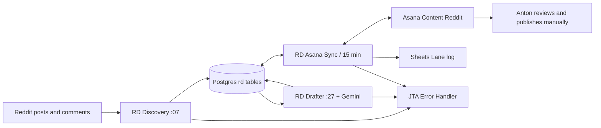

# Архітектура за Confluence v4

| Компонент | Функція |
| --- | --- |
| Discovery | 100 нових постів за запит, дедуплікація, вік до 48 годин, до 6 класифікацій за цикл |
| Читання коментарів | company reading account, тест доступу, до 6 запитів з інтервалом 65 секунд; при відмові cookie_paused |
| Drafter | До 4 чернеток за цикл, Gemini, три self-checks, кодові обмеження |
| Asana Sync | Завдання, рух секцій, рішення, посилання на опублікований коментар, рядок на зміну стану |
| rd_posts | Пости, класифікації, чернетки, рішення |
| rd_config | Налаштування та ID інтеграцій |
| rd_subreddits | Дозволені спільноти |
| rd_run_log | Журнал запусків |
| rd_account_comments | Історія для self-check 1 |

ID і значення: config/documented-settings.json.
Часова зона розкладів n8n у джерелі не вказана; не припускати Europe/Kiev без перевірки.
Реальний DDL і зв'язки таблиць ще не отримано.

